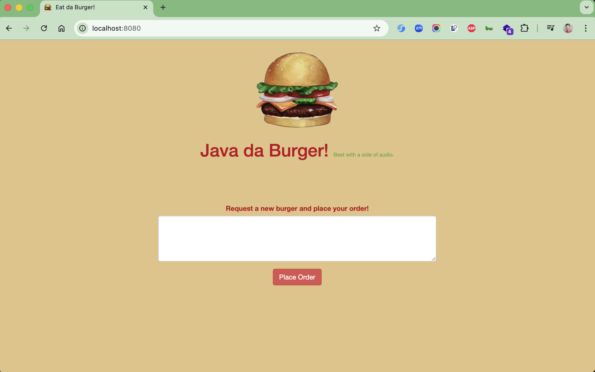

# SpringBurger

[](https://github.com/hendisantika/SpringBurger/actions/workflows/maven.yml)


A re-make of my classic burger app using Java, Maven, MySQL, and the Spring Boot framework.



## Technology Stack

- Java 25 (LTS)
- Spring Boot 4.1.2
- Spring Data JPA
- Spring Web
- Thymeleaf (Template Engine)
- MySQL Database
- Maven 3.10.0 (via Maven Wrapper `./mvnw`)
- Lombok (Reduces boilerplate code)

## Features

- Create and manage burgers
- Track devoured burgers
- Record burger devourers
- Web-based UI with Thymeleaf templates
- RESTful API endpoints

## Prerequisites

### For Docker (Recommended)

- Docker installed
- Docker Compose installed

### For Local Development

- JDK 25 installed (e.g. via `sdk install java 25-tem`)
- Maven is optional — use the bundled Maven Wrapper `./mvnw`
- MySQL Server running
- MySQL database created (see Database Setup)

## Database Setup

1. Start your MySQL server

2. Create the database and tables using the provided schema:
   ```bash
   mysql -u root -p < src/main/resources/schema.sql
   ```
   Or manually execute the SQL commands in `src/main/resources/schema.sql`

3. Update database credentials in `src/main/resources/application.properties` if needed:

```properties
spring.datasource.url=jdbc:mysql://localhost:3306/burgers
spring.datasource.username=root
spring.datasource.password=root
```

## Building the Application

```bash
./mvnw clean package
```

> The `contextLoads` test needs a running MySQL database. Point it to your DB with
> `SPRING_DATASOURCE_URL`, `SPRING_DATASOURCE_USERNAME` and `SPRING_DATASOURCE_PASSWORD`, e.g.:
>
> ```bash
> docker compose up -d mysql
> SPRING_DATASOURCE_URL=jdbc:mysql://127.0.0.1:3306/burgers \
> SPRING_DATASOURCE_USERNAME=yu71 SPRING_DATASOURCE_PASSWORD=53cret ./mvnw clean verify
> ```

To build without running tests:

```bash
./mvnw clean package -DskipTests
```

## Running the Application

### Option 1: Using Docker (Recommended)

The easiest way to run the application is using Docker Compose, which will start both the application and MySQL
database:

```bash
docker-compose up -d
```

This will:

- Start MySQL 26.7.0 container with the database schema automatically initialized
- Build and start the Spring Boot application
- The application will be available at `http://localhost:8080`

To stop the application:

```bash
docker-compose down
```

To stop and remove volumes (clears database data):

```bash
docker-compose down -v
```

**Docker Environment Details:**

- MySQL Version: `26.7.0`
- MySQL Database: `burgers`
- MySQL Username: `yu71`
- MySQL Password: `53cret`
- MySQL Port: `3306`
- Application Port: `8080`

**Note:** MySQL 26.7.0 requires a `tmpfs` mount for `/var/run/mysqld` to properly handle unix socket files. This has been
configured in the docker-compose.yml file

### Option 2: Running Locally

After building, run the application using:

```bash
java -jar target/spring-burger-0.0.1-SNAPSHOT.jar
```

Or use Maven:

```bash
./mvnw spring-boot:run
```

The application will start on `http://localhost:8080`

**Note:** For local development, you need to set up MySQL manually (see Database Setup section)

## Project Structure

```
spring-burger/
├── src/
│   ├── main/
│   │   ├── java/
│   │   │   └── com/hendisantika/springburger/
│   │   │       ├── SpringBurgerApplication.java
│   │   │       ├── config/
│   │   │       │   └── MyDatabaseConnection.java
│   │   │       ├── controller/
│   │   │       │   └── IndexController.java
│   │   │       └── model/
│   │   │           ├── Burger.java
│   │   │           └── Devourer.java
│   │   └── resources/
│   │       ├── application.properties
│   │       ├── application-docker.properties
│   │       ├── schema.sql
│   │       ├── templates/
│   │       │   ├── index.html
│   │       │   └── fragments/
│   │       │       └── burgers.html
│   │       └── public/
│   │           ├── img/
│   │           ├── js/
│   │           └── style/
│   └── test/
│       └── java/
├── .github/
│   ├── dependabot.yml
│   └── workflows/maven.yml
├── Dockerfile
├── docker-compose.yml
├── mvnw / mvnw.cmd
└── pom.xml
```

## Docker Support

The application includes full Docker support with:

- **Dockerfile**: Multi-stage build (`maven:3.9-eclipse-temurin-26-alpine` compiles with `--release 25` → runs on `eclipse-temurin:25-jre-alpine`)
- **docker-compose.yml**: Complete setup with MySQL 26.7.0 database
- **Automatic database initialization**: Schema is loaded on first startup
- **Health checks**: Ensures MySQL is ready before starting the application
- **Persistent volumes**: Database data persists between container restarts
- **Spring profiles**: Separate configuration for Docker and local environments
- **MySQL 26.7.0 Support**: Configured with tmpfs mount to handle unix socket files properly

### Useful Docker Commands

```bash
# Start services
docker-compose up -d

# View logs
docker-compose logs -f app

# Access MySQL container
docker exec -it springburger-mysql mysql -uyu71 -p53cret burgers

# Rebuild after code changes
docker-compose up -d --build

# Stop services
docker-compose down

# Stop and remove all data
docker-compose down -v
```

## Lombok Integration

This project uses **Lombok** to reduce boilerplate code in model classes. Lombok provides annotations that automatically
generate:

- Getters and setters (`@Data`)
- Constructors (`@NoArgsConstructor`, `@AllArgsConstructor`)
- `toString()`, `equals()`, and `hashCode()` methods
- And much more!

### Model Classes Using Lombok

Both `Burger` and `Devourer` entities use the following Lombok annotations:

- `@Data` - Generates getters, setters, toString, equals, and hashCode
- `@NoArgsConstructor` - Generates a no-argument constructor (required by JPA)
- `@AllArgsConstructor` - Generates a constructor with all fields

This significantly reduces code verbosity while maintaining full functionality.

## Continuous Integration

GitHub Actions workflow [`.github/workflows/maven.yml`](.github/workflows/maven.yml) runs on every push / pull request to `master`:

- Sets up **Temurin JDK 25** with Maven dependency caching
- Starts a **MySQL 26.7.0 service container** so the Spring context test can connect
- Runs `./mvnw -B verify` and uploads Surefire reports when the build fails
- Builds the **Docker image** to make sure the `Dockerfile` stays valid
- Submits the Maven dependency graph (push to `master` only) to improve Dependabot alerts

## Dependabot

[`.github/dependabot.yml`](.github/dependabot.yml) keeps dependencies fresh:

| Ecosystem        | Schedule            | Grouping                                                     | Commit prefix   |
|------------------|---------------------|--------------------------------------------------------------|-----------------|
| Maven            | daily 05:00 WIB     | `spring-boot`, `test-dependencies`, `maven-minor-patch`      | `build(deps)`   |
| GitHub Actions   | daily 05:00 WIB     | all actions in one PR                                        | `ci(deps)`      |
| Docker           | weekly (Monday)     | — (`maven` image & `eclipse-temurin` majors ignored to stay on JDK 25) | `build(docker)` |
| Docker Compose   | weekly (Monday)     | —                                                            | `build(docker)` |

All PRs are labelled (`dependencies` + ecosystem) and assigned to the maintainer.

## Recent Updates

- **Upgraded to JDK 25** (pom, GitHub Actions, Docker images) and Maven Wrapper 3.10.0
- Lombok is registered explicitly as an annotation processor (required since JDK 23)
- **GitHub Actions is green again**: MySQL service container for tests, Docker build job
- **Enhanced Dependabot**: grouped updates, labels, commit prefixes, Docker & Compose tracking
- Upgraded to Spring Boot 4.1.2
- MySQL bumped to 26.7.0 (docker-compose and CI service container)
- **Added Lombok support** to reduce boilerplate code in model classes
- Added Docker and Docker Compose support with MySQL 9.5.0
- Configured MySQL 9.5.0 container with custom credentials (username: `yu71`, password: `53cret`)
- Fixed MySQL 9.5.0 socket handling with tmpfs mount for `/var/run/mysqld`
- Added Spring profile configuration for Docker environment
- Migrated from javax.persistence to jakarta.persistence for Spring Boot 3.x compatibility
- Updated JUnit 4 to JUnit 5 (Jupiter)
- Refactored model classes to use Lombok annotations
- Updated to Spring Boot 3.5.7 (later 4.x)

## License

This project is open source and available for educational purposes.
